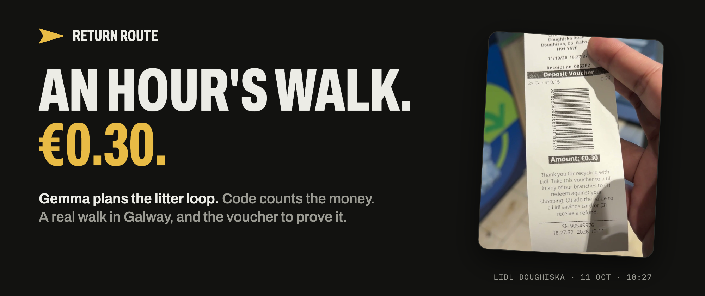
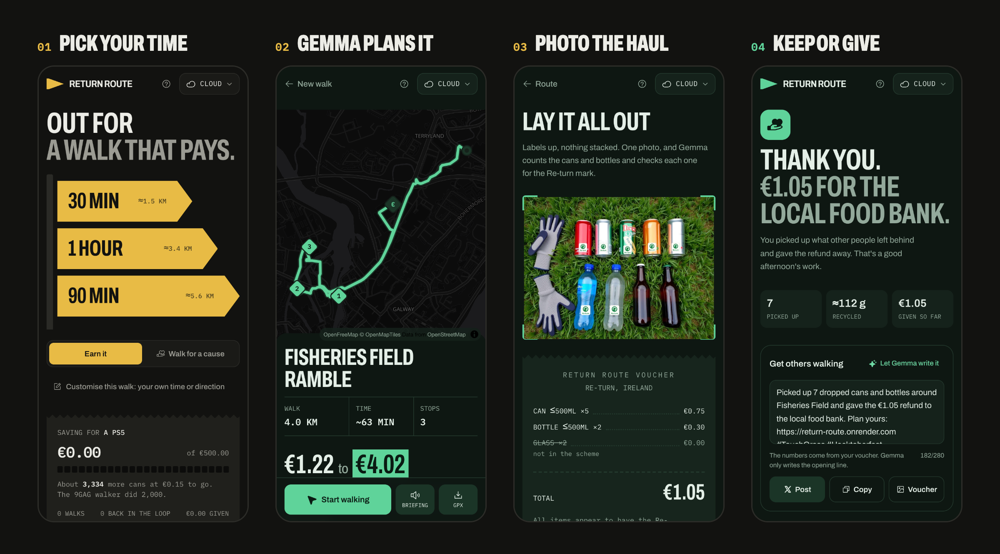
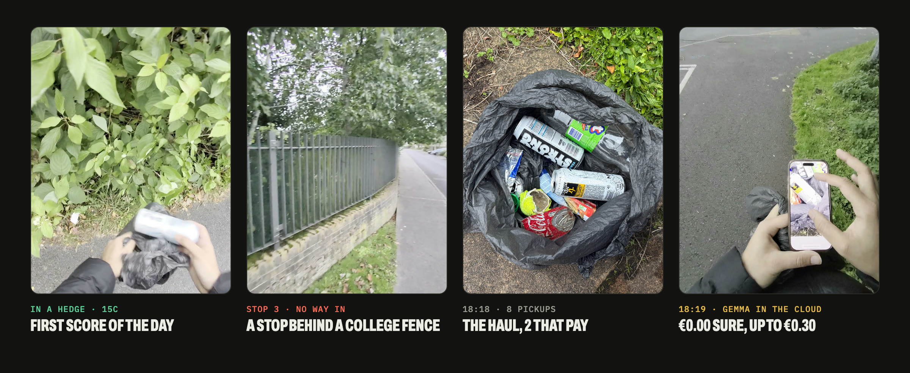
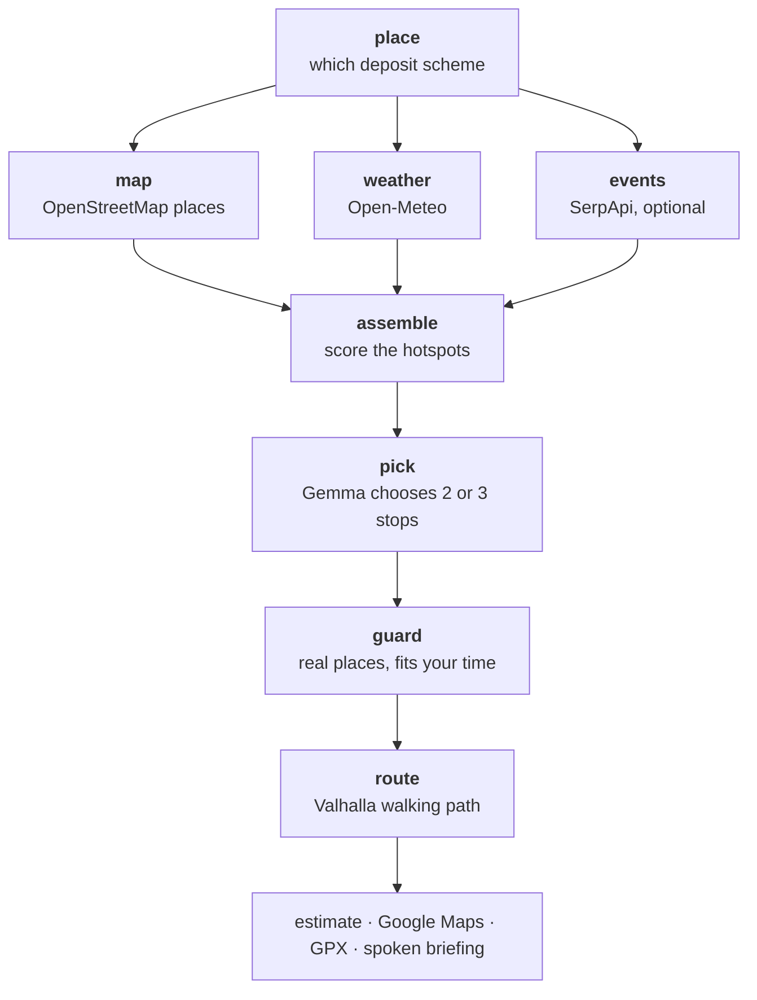
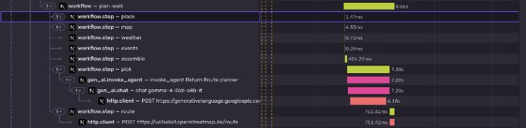
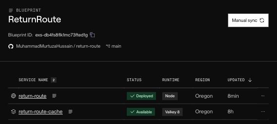
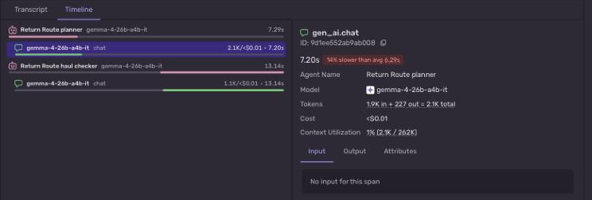

<div align="center">



# Return Route

**A walk that pays.** Gemma plans a loop through the spots where cans and bottles get left behind,<br>and ends it at a deposit return machine. Keep the refund, or give it away.

[](https://return-route.onrender.com)
[](https://return-route.onrender.com/?demo)
[](https://youtu.be/NBnc0FkvwoU)
[](LICENSE)

[](https://ai.google.dev/gemma)
[](https://mastra.ai)
[](https://render.com)
[](https://sentry.io)
[](https://dev.to/challenges/hacktoberfest-week1-2026-10-05)

</div>

---

Ireland's Re-turn scheme pays 15c for a can or a small bottle and 25c for a big one, so every can in a hedge is a refund nobody claimed. Return Route turns that into a reason to go outside. Tell it how long you've got. It plans a walk past picnic tables, pitches and viewpoints near off-licences, gives you an honest range for what you might make, hands the route to Google Maps, and then gets out of your way.

When you're back, take one photo of your haul. Gemma counts the containers, flags the ones the machine will refuse and works out your refund from the deposit table. Keep the money, or switch to **Walk for a cause**: the app turns green, counts what you've given, and Gemma drafts a post to get others walking.



<sub>Screens from the live site: a real plan from Terryland Forest Park on Gemma 26B, then the app's sample haul photo (generated, with deposit stickers so the marks are readable).</sub>

It covers Ireland's Re-turn and 18 other European deposit schemes. Return Route is unofficial and not affiliated with Re-turn or any scheme operator.

## We took it outside

On 11 October 2026 we planned a 90-minute walk in east Galway and went. The app guessed **€1.05 to €3.85**. We picked up 8 bits of litter, 2 of them paid, and the Re-turn machine at Lidl printed a voucher for **€0.30**: a cleaner neighbourhood than the planner expected.



<table>
  <tr>
    <td width="50%" valign="top">
      <a href="https://youtu.be/NBnc0FkvwoU"></a>
      <br><sub><b>The full walk</b> · 12 minutes, 13 chapters, filmed on Ray-Ban Meta glasses</sub>
    </td>
    <td width="50%" valign="top">
      <a href="https://youtube.com/shorts/PUGyHXOnkZs"></a>
      <br><sub><b>The one-minute reel</b> · the same walk, start to voucher</sub>
    </td>
  </tr>
</table>

What the walk taught us, and what changed because of it:

- **The stops were the quietest part.** The cans were in hedges and along the road near the off-licence, not at the picnic tables. Every logged walk shifts the hotspot estimate for the stops you visited.
- **A stop behind a fence is a dead end.** One stop sat behind a college fence. Places inside school or childcare grounds, and anything mapped as private, are no longer stops.
- **Photo close, labels up.** From above, in a bag, Gemma couldn't confirm the small Re-turn logos, so it promised nothing it couldn't see. The voucher's + button fixes the count by hand.
- **Crushed doesn't pay.** Pick them up anyway. And bring gloves.

## Gemma judges, code guarantees

Gemma does the parts that need judgement: it reads what you ask for ("finish at Tesco, stay off the main road"), picks and orders the stops, explains each one in a line, and reads your haul photo. Everything that must be right is plain code that Gemma can't override.

| Gemma decides | Code guarantees |
| --- | --- |
| Which stops, in what order, and why each one | Every stop is a real place from the map, and the walk fits your time ([guard.ts](src/lib/ai/guard.ts)) |
| What's in the photo: material, size, mark visible, crushed or not | What it pays, from the deposit table ([countries.ts](src/lib/countries.ts)) |
| What to look for, and one safety tip | The place names in the spoken briefing ([pipeline.ts](src/lib/plan/pipeline.ts)) |
| One opening line for your post | The count, the amount and the cause in that post |

Gemma never sends anyone into a bin, never promises cash (any sentence with an amount is stripped), and never invents a stop (it's dropped). Every time the guard overrules Gemma, that's a Sentry issue tagged with the tier and the model.

## Gemma, three ways

The same open-weight Gemma family runs wherever you choose. The prompts, the guard and the deposit table are the same for all three.

| Where | Model | Where your haul photo goes |
| --- | --- | --- |
| **In the cloud** | Gemma 4 26B-A4B through Google AI Studio | To Google |
| **On your laptop** | Gemma 4 E4B through [Ollama](https://ollama.com) | Nowhere: it stays on your laptop |
| **In your phone's browser** | Gemma 4 E2B on WebGPU ([transformers.js](https://huggingface.co/onnx-community/gemma-4-E2B-it-ONNX)), about 3.4 GB once | Nowhere: it's read on the phone |

> [!NOTE]
> The phone tier is built and bundled, but it hasn't been tested on a real phone yet. The cloud and laptop tiers are the tested ones.

Planning needs open map, weather and routing services (OpenFreeMap, Open-Meteo, Valhalla), so your start point goes to those whichever tier you pick. There are no accounts: your totals and walk history stay in your browser.

## How a walk is planned

Planning is a [Mastra](https://mastra.ai) workflow ([planWalk.ts](src/mastra/workflows/planWalk.ts)). The map, the weather and today's events are fetched in parallel.



The score is a hotspot prior for each kind of place, times yesterday's weather (a warm evening leaves cans behind), the day of the week, any match or gig nearby, and your own past hauls. Nobody has a live litter feed, so the estimate starts as an honest guess. A country with no deposit scheme stops at the first step with a plain message. The phone tier runs the first half on the server, then Gemma picks in a Web Worker ([edge.worker.ts](src/lib/ai/edge.worker.ts)) and the server guards and routes the result.

The haul is simpler: **photo → Gemma (vision) → items → deposit table → itemised voucher.**

One plan from the live site, traced in Sentry. Gemma is 7.2 of the 8.7 seconds:



## Measured

8 Galway walks per server tier, with notes like "finish at Lidl" or "stay off the main road", run before and after moving the planning rules into code (`pnpm eval:plan`, results in [eval/results](eval/results)):

| Tier | Plans the guard didn't touch | Too long | Invented stop | Finished where asked | Time per plan |
| --- | --- | --- | --- | --- | --- |
| Cloud, 26B-A4B, before | 7/8 | 1 | 0 | 4/5 | 5.2 s |
| Cloud, 26B-A4B, after | **8/8** | **0** | 0 | **5/5** | 5.3 s |
| Laptop, E4B, before | 6/8 | 2 | 0 | 4/5 | 5.7 s |
| Laptop, E4B, after | **7/8** | **0** | 1 | **5/5** | 5.4 s |

This shows Gemma follows the rules, not that the stops have cans. Only walking tells you that.

## Works anywhere with a deposit scheme

Public map servers rate-limit busy cloud servers, and Render's free tier shares its outbound IPs with many apps. So map data has a chain of fallbacks: the Render Key Value cache, bundled Galway snapshots, OpenFreeMap vector tiles from a CDN (a 30-minute area in 1 to 2 seconds in Galway, Berlin, Copenhagen, Amsterdam and Vienna), full Overpass, and finally the walker's own browser. Weather is always fetched by the browser. Planned walks are checked against the real walking path, so a river with one bridge can't turn 30 minutes into 50.



## Observability without the walker's location



Each plan is a trace with a span per workflow step and a `gen_ai` agent span per Gemma call (model, tier, latency, tokens), and every guard override is an issue ([telemetry.ts](src/lib/server/telemetry.ts)). No prompts, photos or typed text are sent, and there is no session replay. Weather and place URLs carry coordinates and our cache keys carry IPs, so [privacy.ts](src/lib/privacy.ts) strips URL query strings and cuts cache keys down to their kind before anything leaves the server or the browser.

<details>
<summary><b>Optional services</b>: each one is off until its environment variable is set</summary>
<br>

- **Render Key Value** (`REDIS_URL`): one shared cache for map areas, today's events and the rate limits, so a busy Overpass server or a restart doesn't cost a plan. [render.yaml](render.yaml) creates it.
- **Sentry** (`SENTRY_DSN`, `NEXT_PUBLIC_SENTRY_DSN`): the traces and guard issues above. Off unless set, so forks don't report to our project.
- **SerpApi** (`SERPAPI_KEY`, on a plan that includes the Google Events engine): today's events in town. Only the town's name is sent. Venues are placed on the map by name, and stops near one get a boost and a reason ("Galway United vs Derry City at Eamonn Deacy Park today"). ([events.ts](src/lib/server/events.ts))

</details>

## Run it

```bash
pnpm install
cp .env.example .env.local     # pick MODEL_PROVIDER=ollama or google
ollama pull gemma4:e4b         # for the laptop tier
pnpm dev                       # http://localhost:3100
```

- **Guided demo:** open [`/?demo`](https://return-route.onrender.com/?demo), or tap the demo button on the home screen. It plans a real walk from Terryland Forest Park with Gemma, plays it on the map, shows the real haul from our test walk and the voucher it earned (two cans at 15c, €0.30), gives the refund away and drafts the post. If Gemma can't be reached it shows a recorded plan, and says so. Your real totals are never touched.
- **Phone tier (untested):** open the app in Chrome on Android or desktop, go to Settings and choose **On this phone**. The first time, it downloads about 3.4 GB of weights, so use wifi.
- **Tests:** `pnpm test` (54 tests).
- **Evals:** `pnpm eval:plan` for the planner; `pnpm eval` reads haul photos with true counts from `eval/hauls/`.

<details>
<summary><b>Where to look in the code</b></summary>
<br>

| File | What it does |
| --- | --- |
| [src/lib/ai/guard.ts](src/lib/ai/guard.ts) | Every rule Gemma can't break: real stops only, no money talk, no bins |
| [src/lib/countries.ts](src/lib/countries.ts) | 19 deposit schemes, and the only place money comes from |
| [src/mastra/workflows/planWalk.ts](src/mastra/workflows/planWalk.ts) | The planning workflow |
| [src/lib/plan/overpass.ts](src/lib/plan/overpass.ts), [tiles.ts](src/lib/plan/tiles.ts) | OpenStreetMap places, minus anything behind a school gate |
| [src/lib/ai/edge.worker.ts](src/lib/ai/edge.worker.ts) | Gemma 4 E2B in the browser on WebGPU |
| [src/lib/privacy.ts](src/lib/privacy.ts) | What Sentry never sees |

</details>

## Data and credits

- Map data © [OpenStreetMap](https://www.openstreetmap.org/copyright) contributors (ODbL), read from [OpenFreeMap](https://openfreemap.org)'s vector tiles (the same tiles the map draws), with mapped return machines from Overpass.
- Map tiles from [OpenFreeMap](https://openfreemap.org). Routing by [Valhalla](https://github.com/valhalla/valhalla) on the FOSSGIS server. Weather from [Open-Meteo](https://open-meteo.com). Events from Google Events via [SerpApi](https://serpapi.com), when a key is set.
- Deposit rates come from [re-turn.ie](https://re-turn.ie) and TOMRA's 2026 overview.
- `data/galway.json` and `data/galway-east.json` are OpenStreetMap snapshots, so Galway plans instantly and the demo never waits on a map server.
- The demo's haul photo (`public/demo/real-haul.jpg`) is the real bag from our test walk on 11 October 2026. "Try a sample photo" uses `public/demo/haul.jpg`, generated with [FLUX.1-dev](https://huggingface.co/black-forest-labs/FLUX.1-dev) on its Hugging Face Space, with deposit-mark stickers added so Gemma has marks it can read.

## Good manners

Pick up litter from the ground only. Leave bins, and in Germany the Pfandring, for the people who rely on them. Wear gloves, leave broken glass alone, and don't crush the cans, because the machines reject crushed ones.

---

<div align="center">
<sub>Made by <a href="https://muhammadmurtuza.com">Muhammad Murtuza Hussain</a> for the <a href="https://dev.to/challenges/hacktoberfest-week1-2026-10-05">Hacktoberfest Open-Source AI Challenge, Week 1: Touch Grass</a>. MIT licensed.</sub>
</div>
